# LiDAR Point Cloud Analysis, Pipeline Inspection & Object Detection

<table>
  <tr>
    <td></td>
    <td></td>
  </tr>
  <tr>
    <td align="center">Raw mobile-mapping point cloud</td>
    <td align="center">Pipeline corridor — RandLA-Net semantic predictions</td>
  </tr>
</table>

An end-to-end pipeline for analysing mobile-mapping LiDAR data along **underground gas pipelines**.
The pipelines themselves are invisible to LiDAR, so the goal is to find and classify every object
that sits **above or near** them (walls, buildings, trees, vehicles, poles), tell **movable** from
**permanent** objects, and rank them by **proximity risk** to the pipeline.

**Tech stack:** Python · laspy · Open3D · CSF · scikit-learn · XGBoost · GeoPandas / Shapely · PyTorch · Open3D-ML (RandLA-Net)

---

## Problem

- A survey vehicle with LiDAR, GNSS/GPS and IMU drives the streets at 20, 30 and 40 km/h, producing three large point clouds (**~104–134 million points each**).
- Two pipeline GIS layers are available as line shapefiles: service lines (**HAL**, 31 segments, ~702 m) and distribution lines (**VL**, 5 segments, ~1311 m).
- Objects near the pipelines need to be **detected**, **classified** and **prioritised** for inspection.
- Walls, vegetation and parked vehicles can **occlude** parts of the corridor, so scan coverage must be assessed as well.

## Approaches

| Approach | Description | Status |
|---|---|---|
| **Classical pipeline** | Corridor extraction → ground/noise filtering → DBSCAN clustering → geometric features → RF / XGBoost classification → risk zones | ✅ Working (core) |
| **Transfer learning** | Pretrained RandLA-Net (SemanticKITTI) via Open3D-ML, per-point semantic labels without any training | ✅ Proof of concept |
| **SAM-based segmentation** | `segment-lidar`: rasterise to top-down image → Segment Anything → back-project to 3D | ⚠️ Attempted, blocked by dependency conflicts |

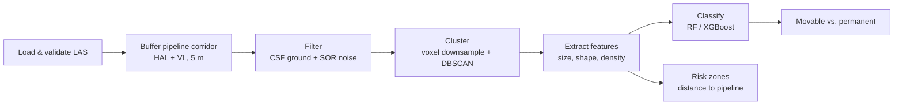

---

## Pipeline

### 1. Data inspection — `01_data_inspection.ipynb`
- Checked every LAS field in every file for real vs. empty data instead of assuming.
- **Populated:** X, Y, Z, intensity, return_number, gps_time, RGB.
- **Empty / placeholder:** classification, scan_angle_rank, number_of_returns and several flag fields.
- Checked min/max ranges per attribute and plotted height distributions to understand the scene structure.

### 2. Pipeline corridor extraction — `02_pipeline_extraction.ipynb`
- Verified the coordinate systems. The GIS layers use **EPSG:25832** and the LiDAR uses **EPSG:32632**. Correcting the small shift between them was essential for accurate matching.
- Merged all HAL/VL segments into one geometry and buffered it into a **5 m corridor polygon**.
- Extracted only the points inside the corridor, reducing tens of millions of points to a focused subset. A full-field version is kept for coverage analysis and an XYZ-only version is used downstream.
- Coverage check: the 40 km/h pass covers noticeably less of the network than the 20/30 km/h passes.

| Pipeline network (HAL + VL) | Pipelines on LiDAR (full survey) | Pipelines on LiDAR (20/30 km/h) |
|---|---|---|
| 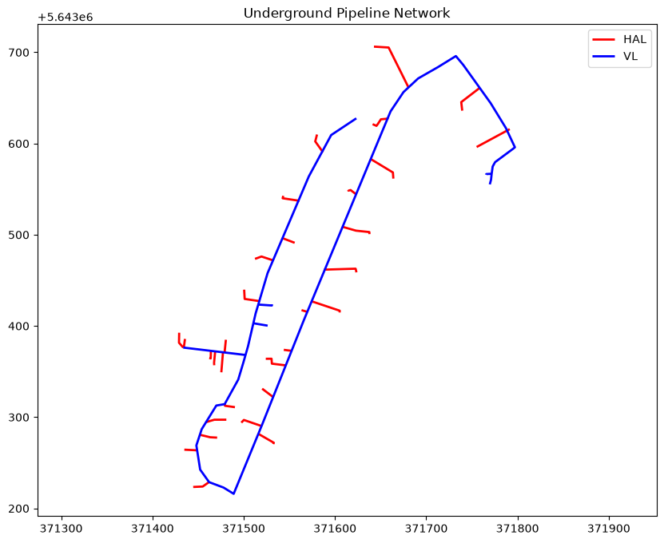 | 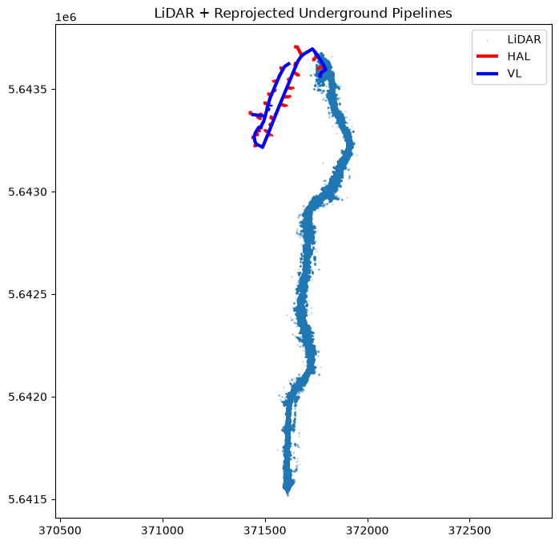 | 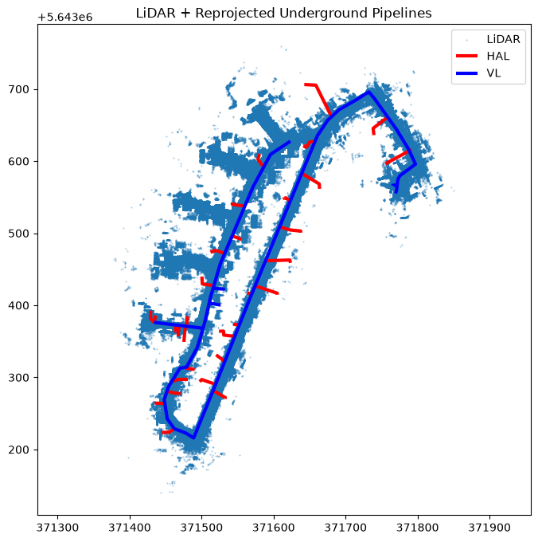 |

| Extracted 5 m corridor (20/30 km/h) | Extracted 5 m corridor (40 km/h) |
|---|---|
| 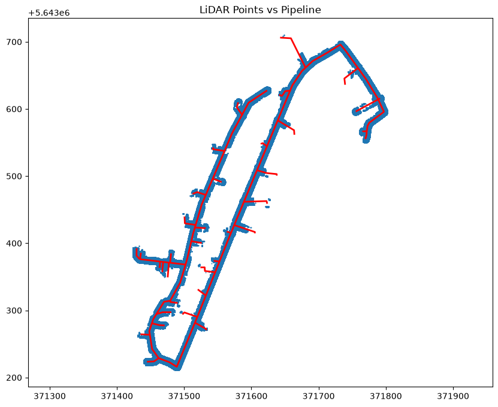 | 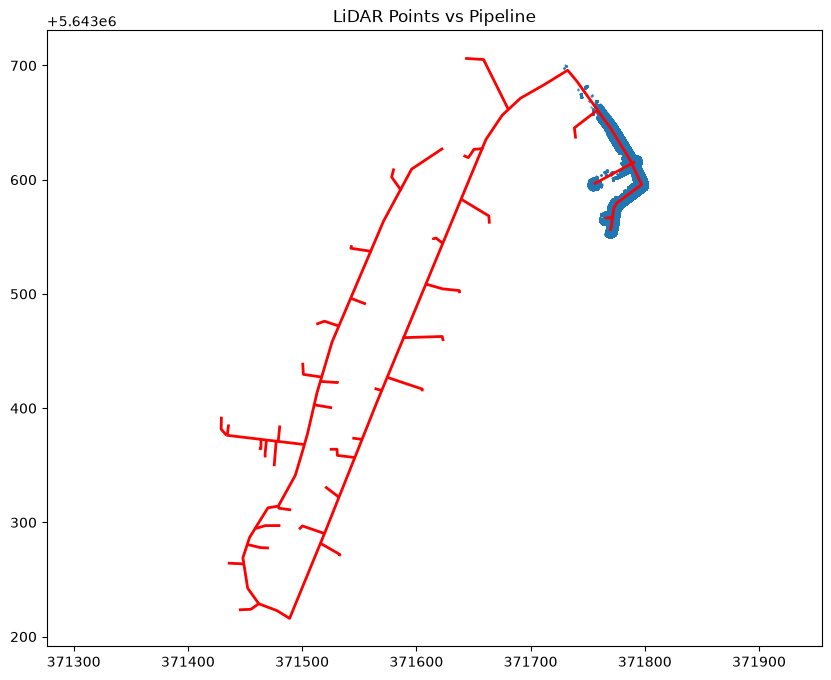 |

### 3. Filtering — `03_filtering.ipynb`
- **Cloth Simulation Filter (CSF)** separates the road/ground surface from the objects of interest.
- **Statistical Outlier Removal (SOR)** removes sparse noise points based on local neighbourhood density.

| Corridor points | After CSF (non-ground) | After CSF + SOR |
|---|---|---|
|  |  |  |

### 4. Clustering — `04_feature_clustering.ipynb`
- Voxel downsampling followed by **DBSCAN** on XYZ, leaving about 5% of points as noise.
- Also explored:
  - **RANSAC plane fitting:** discarded because it removed too many object points.
  - **Geometric shape features** (planarity, linearity, scatter, verticality) in the clustering space: clusters separated better but large objects fragmented at their edges. Plain XYZ gave the best balance.

| Clusters | Single object (top) | Single object (side) |
|---|---|---|
|  |  |  |

### 5. Features & pipeline risk zones — `04` / `05_feature_extraction.ipynb`
- Kept clusters with **more than 100 points** and computed width, length, height, volume, density, centroid, elongation and flatness for each.
- Computed each object's **minimum distance to the nearest pipeline segment** and assigned a risk zone:

| Risk | Distance to pipeline | Action |
|---|---|---|
| 🔴 High | < 2 m | Priority inspection / monitoring |
| 🟠 Medium | 2–5 m | Periodic review |
| 🟢 Low | > 5 m | Minimal immediate concern |

<p align="center"><br/><em>Detected objects near the pipeline, coloured by risk zone</em></p>

### 6. Object classification — `06_classification.ipynb`
- Merged the features from all three passes and **manually labelled 86 clusters**: vehicle (37), wall (21), building (17), tree (8) and pole (3).
- Trained and compared **Random Forest** and **XGBoost** on point count, size, volume, density, elongation and flatness.
- **Movable vs. permanent** is derived from the object type with rules (vehicle → movable).

| Model | Accuracy | Weighted F1 | Vehicle F1 | Top features |
|---|---|---|---|---|
| Random Forest | 0.61 | 0.61 | 0.82 | height, volume, width |
| XGBoost | 0.61 | 0.64 | 0.93 | volume, flatness, height |

Vehicles are classified reliably. The rare classes (pole, tree) suffer from very few samples. The held-out test set has only 18 clusters, so treat these numbers as indicative.

<p align="center">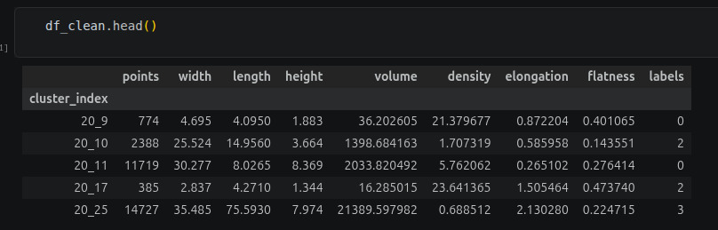<br/><em>Per-cluster features used for classification (labels: 0 building, 1 pole, 2 tree, 3 wall, 4 vehicle)</em></p>

<p align="center">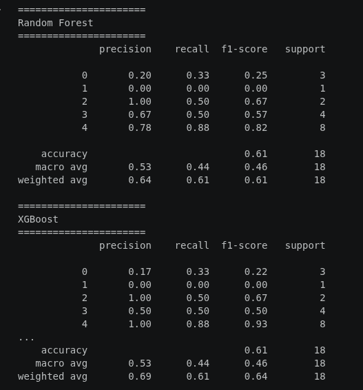<br/><em>Classification report — Random Forest vs. XGBoost</em></p>

**Objects identified by the models** (top, side and front views of each cluster):

| Vehicle → predicted **vehicle** · Movable | Wall → predicted **wall** · Non-movable |
|---|---|
| 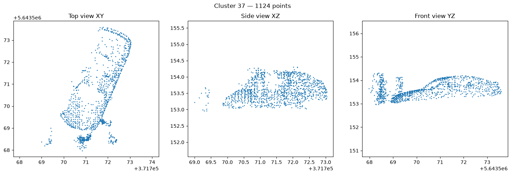<br/><sub>Cluster 37, 20 km/h, 1124 points</sub> | 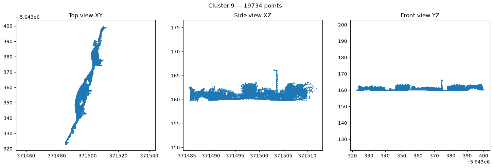<br/><sub>Cluster 9, 30 km/h, 19734 points</sub> |
| **Building → predicted building · Non-movable** | **Tree → predicted tree · Non-movable** |
| 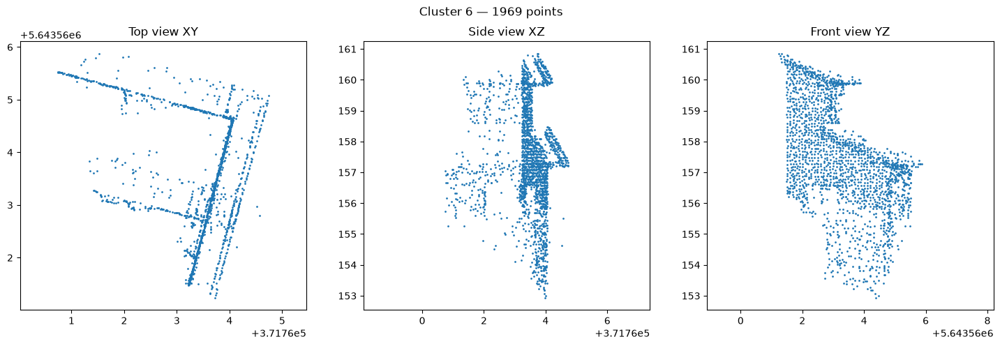<br/><sub>Cluster 6, 30 km/h, 1969 points</sub> | 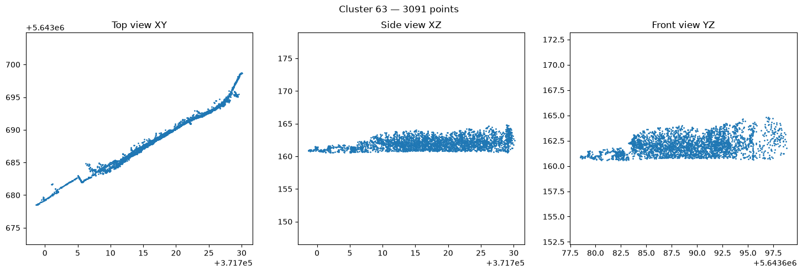<br/><sub>Cluster 63, 30 km/h, 3091 points</sub> |

All four objects were classified correctly by both Random Forest and XGBoost.

**Failure case:** a pole merged with a neighbouring object during clustering. The cluster's overall shape looks like a car, so Random Forest predicted **vehicle** (XGBoost predicted building). This shows how DBSCAN merges and the small pole class (3 samples) limit accuracy.

<p align="center">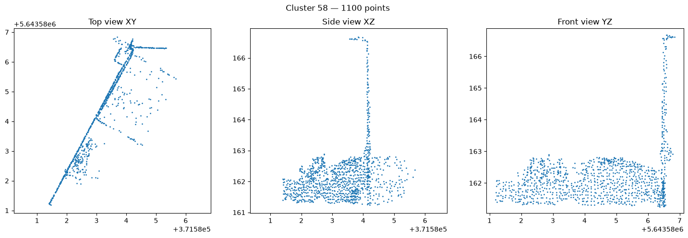<br/><sub>Cluster 58, 20 km/h, 1100 points: actual pole → predicted vehicle</sub></p>

### 7. Transfer learning with RandLA-Net — `07_dl_exploration (randlanet_semantickitti).ipynb`
- Ran the pretrained **RandLA-Net (SemanticKITTI)** checkpoint on the 40 km/h corridor as a proof of concept. It needs no labels and produces per-point classes (car, building, vegetation, pole, …).
- It shows that pretrained models can transfer to new data, but there is a clear **domain gap** (different sensor and city). Fine-tuning would be needed for production.

| Input: LiDAR points near the pipeline (40 km/h) | SemanticKITTI-pretrained RandLA-Net predictions |
|---|---|
| 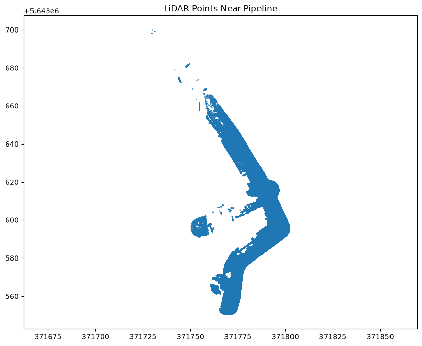 | 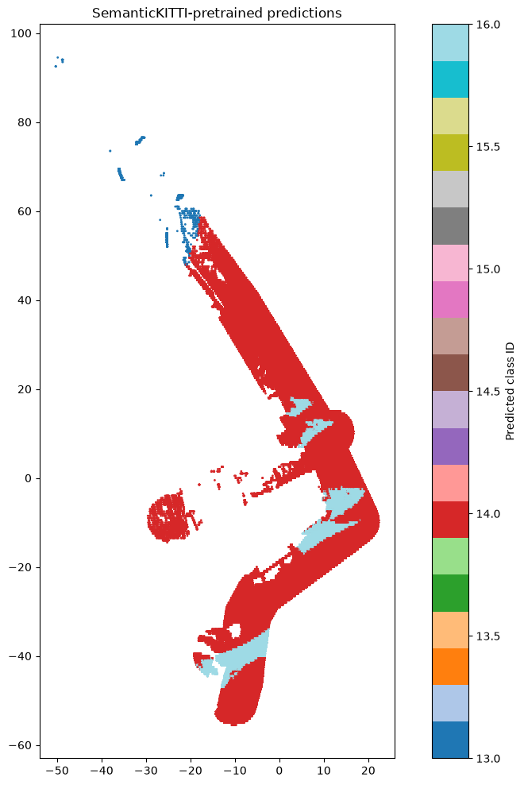 |

### 8. What didn't work: SAM-based segmentation (`segment-lidar`)
The idea was to rasterise the point cloud to a top-down image, segment it with Meta's Segment Anything Model, then back-project the 2D masks onto the 3D points.
- [segment-lidar](https://github.com/Yarroudh/segment-lidar) pins `numpy==1.24.3`, which conflicts with `scipy`/`open3d` (`numpy>=1.26`).
- Its official Docker image runs Python 3.8, which can't satisfy the `numpy>=2.0` requirement of the bundled CSF dependency.
- I documented the problem rather than work around it with heavy version pinning, and focused on the two working approaches.

---

## Coverage analysis & blind-spot detection (design)

Occlusions can hide parts of the pipeline corridor from the scanner. The planned approach:

1. Split the pipeline into short intervals (1–5 m) and measure LiDAR point coverage per interval.
2. Flag intervals with zero or insufficient coverage as **potential blind spots**.
3. Use `gps_time` and the vehicle trajectory to separate **not scanned** from **scanned but occluded**.
4. Cross-reference blind spots with nearby classified objects:
   - wall / building → likely **permanent** occlusion
   - vehicle → **temporary** obstruction
   - vegetation → **seasonal** obstruction
   - unknown → manual review
5. Compare multiple passes to separate persistent blind spots from temporary ones.
6. Refine with voxel occupancy, distance to trajectory and observation geometry.

**Output:** a coverage map showing coverage quality, blind spots and their likely causes. Persistent gaps can then be targeted with complementary acquisition such as drone LiDAR or aerial imagery.

---

## Project structure

```
├── src/
│   ├── 01_data_inspection.ipynb        # LAS field validation & statistics
│   ├── 02_pipeline_extraction.ipynb    # CRS alignment, corridor buffering, point extraction
│   ├── 03_filtering.ipynb              # CSF ground filter + SOR outlier removal
│   ├── 04_feature_clustering.ipynb     # Voxel + DBSCAN clustering, risk zones
│   ├── 05_feature_extraction.ipynb     # Per-cluster features & manual annotation
│   ├── 06_classification.ipynb         # Random Forest / XGBoost, movable vs. permanent
│   ├── 07_dl_exploration (randlanet_semantickitti).ipynb  # RandLA-Net transfer learning
│   └── extra_dim/                      # Experiments with extra geometric dimensions
├── results/                            # Figures per pass (20 / 30 / 40 km/h)
├── requirements.txt
└── README.md
```

## Setup

### 1. Install

Requires **Python 3.11**.

```bash
python3.11 -m venv lidar_env

# Linux / macOS
source lidar_env/bin/activate
# Windows (PowerShell)
lidar_env\Scripts\activate

pip install -r requirements.txt
```

### 2. Add your data

> **Data:** the survey point clouds and pipeline GIS layers are proprietary and **not included** in
> this repository. The pipeline works with any LAS/LAZ point cloud plus a line shapefile of the
> infrastructure of interest. Public alternatives for experimenting include
> [Toronto-3D](https://github.com/WeikaiTan/Toronto-3D), [Paris-Lille-3D](https://npm3d.fr/paris-lille-3d)
> and [SemanticKITTI](http://www.semantic-kitti.org/).

Create a `data/` folder next to `src/` with the raw inputs. The file names are hardcoded in the notebooks:

```
data/
├── pointclouds/        # 20 kmh.las, 30 kmh.las, 40 kmh.las
└── leitungen/          # HAL.shp, VL.shp (+ .shx, .dbf, .prj)
```

All other sub-folders (`processed_pipeline_corridor/`, `processed_non_ground_sor/`, `npy_files/`, `csv/`) are **created by the notebooks** as you run them.

### 3. Run the notebooks

Start Jupyter **from inside `src/`**, because all paths are relative (`../data/...`):

```bash
cd src
jupyter lab
```

Run them **in order**. Some steps handle one survey pass at a time. Change the speed in the file name / `number` variable (`20` / `30` / `40`) and re-run for each pass.

| Notebook | Reads | Writes |
|---|---|---|
| `01_data_inspection` | `pointclouds/*.las`, `leitungen/*.shp` | — (analysis only) |
| `02_pipeline_extraction` | `pointclouds/*.las`, `leitungen/*.shp` | `processed/{speed}kmh_pipeline_corridor.las` ¹ |
| `03_filtering` | `processed_pipeline_corridor/{speed}kmh_pipeline_corridor.las` | `processed_non_ground_sor/{speed}kmh_pipeline_corridor_nonground_sor.las` |
| `04_feature_clustering` | `processed_non_ground_sor/...`, `leitungen/*.shp` | `csv/{speed}dbscan_*_min100.npy` ², `csv/{speed}kmh_object_features.csv` |
| `05_feature_extraction` | `csv/*_object_features.csv`, `npy_files/*.npy` | manual labels → `csv/ant_df{speed}_.csv` ³ |
| `06_classification` | `csv/ant_df*_.csv`, `npy_files/*.npy` | `csv/all_object_features.csv` |
| `07_dl_exploration` | `processed_pipeline_corridor/40kmh_pipeline_corridor.las` | `src/dataset/` (SemanticKITTI format) |

¹ Move the output to `data/processed_pipeline_corridor/` before running notebook 03.
² Move the `.npy` files to `data/npy_files/` before running notebook 05.
³ The `ant_df*_.csv` files hold the manually annotated cluster labels (building, pole, tree, wall, vehicle). Annotate your own clusters to reproduce notebook 06.

### 4. Extra setup for notebook 07 (RandLA-Net)

1. Install PyTorch with the CUDA version that matches your GPU, following [pytorch.org](https://pytorch.org/get-started/locally/). The notebook was run with `torch==2.2.2`.
2. Clone [Open3D-ML](https://github.com/isl-org/Open3D-ML) and copy `ml3d/configs/randlanet_semantickitti.yml` to `src/configs/`. The config isn't shipped with the pip package.
3. Download the pretrained checkpoint: [randlanet_semantickitti_202201071330utc.pth](https://storage.googleapis.com/open3d-releases/model-zoo/randlanet_semantickitti_202201071330utc.pth)


---

## Limitations

- **Compute:** limited GPU and memory forced chunked/sampled processing. RGB and intensity were not used downstream.
- **Small, imbalanced dataset:** only 86 labelled clusters, 3 of them poles.
- **Manual labels:** there is no ground truth, so the annotations may be biased.
- **Clustering sensitivity:** DBSCAN depends on `eps`/`min_samples`, and adjacent objects (e.g. tree canopy touching a wall) can merge.
- **Domain gap:** RandLA-Net was not fine-tuned and was tested on one pass only.
- **Acquisition variability:** driving speed, point density and occlusion all affect how complete each object is.

## Future work

- Use **all fields** (intensity, RGB, return number, gps_time) throughout the pipeline.
- **Tiled / parallel processing** of large scans to cut memory use.
- **Multi-pass temporal comparison** to reliably separate permanent from movable objects and confirm blind spots.
- **Change-detection alerts** for new objects appearing near the pipeline between surveys.
- **Fine-tune RandLA-Net** on labelled local data and evaluate 3D detectors such as **PointPillars**.
- An **active learning loop:** low-confidence detections → human review → retraining.
- **Sensor fusion** with camera imagery, and **drone LiDAR** to fill ground-level blind spots.
- Explore point-cloud language models (e.g. **PointLLM**).


